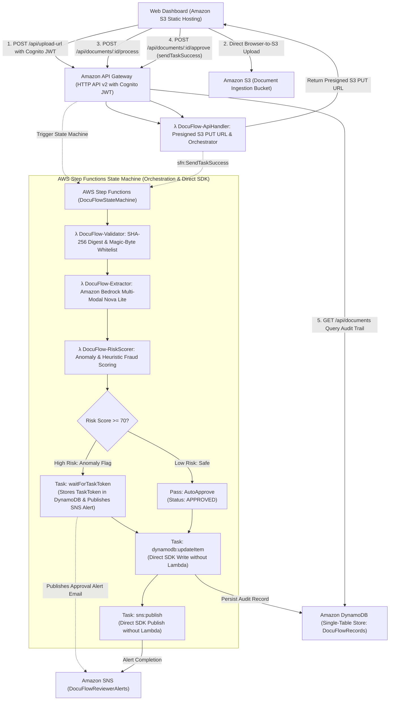

# ⚡ DocuFlow AI: Serverless Multi-Modal Document & Invoice Intelligence Engine
### Submission for the AWS Builder Center Weekend Challenge: *No Pipeline, No Problem* (Nov 13 – 16, 2026)

[](https://aws.amazon.com/serverless/)
[](https://aws.amazon.com/step-functions/)
[](https://aws.amazon.com/bedrock/)
[](https://aws.amazon.com/lambda/)
[](https://aws.amazon.com/dynamodb/)
[](https://aws.amazon.com/cognito/)
[](https://aws.amazon.com/s3/)
[](https://github.com/)

---

## 🌐 Live Cloud Deployment Links

- **Interactive Web Dashboard**: [http://docuflow-frontend-986523046664-us-east-1-an.s3-website-us-east-1.amazonaws.com/](http://docuflow-frontend-986523046664-us-east-1-an.s3-website-us-east-1.amazonaws.com/)
- **API Gateway Base URL**: `https://z9okxb9r8j.execute-api.us-east-1.amazonaws.com`
- **AWS Region**: `us-east-1` (US East, N. Virginia)
- **Cognito User Pool ID**: `us-east-1_sO92E2WYK` (Client ID: `7a4ohh6j10s38a4cio8frddanr`)
- **Reviewer Demo Credentials** *(for testing authenticated Cognito Reviewer role)*:
  - **Email / Username**: `reviewer.demo@example.com` (or `reviewer_demo`)
  - **Password**: `DocuFlowReviewer2026!`

---

## 📌 Problem Statement & Solution

### The Operational Tax of Enterprise Invoicing
Every organization processes hundreds of invoices, receipts, and contracts weekly. Traditional document automation pipelines suffer from heavy operational friction:
- **Server Babysitting**: Provisioning and patching container clusters, load balancers, and persistent database connections for erratic document arrival patterns.
- **Premature Execution & Idle GPU Bloat**: In traditional architectures, compute threads block while waiting for large files to upload, or costly EC2 GPU instances run 24/7 just to host OCR microservices.
- **Fragile Human-in-the-Loop**: Handling human approvals usually requires polling databases, state loss during server restarts, or cron jobs checking for status changes.
- **High Idle Costs**: Paying 24/7 for servers that sit idle during off-peak hours.

### The DocuFlow AI Solution
**DocuFlow AI** eliminates the entire operational tax. By orchestrating **Amazon S3, Amazon API Gateway, AWS Step Functions, AWS Lambda, Amazon Bedrock (Amazon Nova Lite), and Amazon DynamoDB**, DocuFlow AI provides an enterprise-ready, scale-to-zero intelligent document processing workflow with **zero servers to manage and no complex manual deployment pipelines.**

---

## 🏗️ Architecture & Serverless Data Flow



---

## 🌟 The Serverless Building Blocks & Architectural Strengths

| Service | Architectural Role | Why It Exemplifies "No Pipeline, No Problem" |
|---|---|---|
| **Amazon Bedrock** | Serverless Multi-Modal Foundation Model Inference | Invokes **Amazon Nova Lite** (`amazon.nova-lite-v1:0`) via the native Converse API with multi-modal document blocks (PDF) and image blocks (PNG/JPEG). Being AWS's native foundation model, it requires zero GPU provisioning, zero third-party approval wait times, and scales to zero automatically. |
| **AWS Step Functions** | Resilient Visual Orchestration & Direct SDK Tasks | Manages workflow state transitions, retry backoffs, and true asynchronous human-in-the-loop approvals via `waitForTaskToken`. Employs direct SDK integrations (`arn:aws:states:::dynamodb:updateItem` and `arn:aws:states:::sns:publish`) without burning glue Lambda compute. |
| **AWS Lambda** (Python 3.12) | Decoupled Micro-Compute | Decoupled, single-responsibility functions for API triage, SHA-256 validation, Bedrock inference, and risk scoring. Executes in milliseconds and scales down to $0.00 when idle. |
| **Amazon DynamoDB** | Single-Table State Store (`DocuFlowRecords`) | Sub-10ms latency using true numeric `Decimal` attributes for financial precision, GSI1 global secondary index for chronological dashboard queries, and zero connection pool management. |
| **Amazon S3** | Secure Storage & Static Web Hosting | Uses two decoupled buckets: one for static website hosting (zero web servers to manage), and one for document storage with strict presigned URL boundaries. |
| **Amazon Cognito** | Enterprise RBAC & JWT Authorizer | Provisions User Pool `DocuFlowUserPool` with strict `AllowAdminCreateUserOnly: true` closed registration, RBAC `Reviewers` group membership, and native API Gateway JWT verification. |
| **Amazon SNS** | Real-Time Push Alerts | Dispatches high-risk notification emails and review requests directly from Step Functions state transitions without intermediary servers. |
| **Amazon API Gateway** | HTTP API v2 with Native JWT Authorizer | Low-latency REST endpoints for presigned URLs, document processing, and approval callbacks, protected by native Cognito JWT authorizer with zero load balancers. |
| **AWS X-Ray** | Distributed Tracing & Telemetry | Native tracing across API Gateway, Lambda, Step Functions, Bedrock, and DynamoDB providing full latency profiling and service maps. |

---

## 🤖 Why Amazon Bedrock? (True Serverless Multi-Modal AI Without Operational Tax)
Traditional document AI solutions require custom machine learning pipelines: gathering training data, running separate OCR microservices (e.g. Tesseract), provisioning GPU clusters (like EC2 `g5.xlarge`), and configuring auto-scaling endpoints. That is the ultimate "operational tax."

**DocuFlow AI** takes a pure serverless approach using **Amazon Bedrock**:
1. **Zero GPUs or OCR Clusters to Provision**: `DocuFlow-Extractor` calls `bedrock-runtime:Converse` on-demand with raw PDF document blocks and JPEG/PNG image blocks.
2. **Scale to Zero**: If no documents are uploaded, Bedrock costs $0.00.
3. **Multi-Modal Entity Reasoning**: Amazon Nova Lite natively inspects document visual layout, extracting dates, tax IDs, vendor domains, line items, and risk commentary directly into strict JSON format with fail-closed integrity.
4. **Resilient Fallback**: If Bedrock is unreachable or running in an offline test sandbox, a deterministic rule engine takes over automatically.

---

## 🗄️ DynamoDB Single-Table Design (`DocuFlowRecords`)

DocuFlow AI utilizes an efficient single-table access pattern with true numeric Decimals:

| Access Pattern | PK | SK | GSI1PK | GSI1SK | Attributes |
|---|---|---|---|---|---|
| Get Document Details | `DOC#{document_id}` | `METADATA` | — | — | `filename`, `status`, `extracted_data`, `risk`, `task_token`, `security_scan` |
| List Documents (Newest First) | `DOC#{document_id}` | `METADATA` | `DOCS` | `ISO_TIMESTAMP` | Projected attributes for fast dashboard rendering |

---

## 🚀 Live Demo & Hands-On Testing Guide

You can test the live application directly in your browser without installing anything locally:

### 1. Open the Live Web Dashboard
Visit: **[http://docuflow-frontend-986523046664-us-east-1-an.s3-website-us-east-1.amazonaws.com/](http://docuflow-frontend-986523046664-us-east-1-an.s3-website-us-east-1.amazonaws.com/)**

### 2. Sign In as a Verified Reviewer
1. In the top bar, click **⚙️ Connect & Sign In**.
2. Enter the demo Reviewer credentials:
   - **Reviewer Email**: `reviewer.demo@example.com` (or username `reviewer_demo`)
   - **Password**: `DocuFlowReviewer2026!`
3. Click **Sign In with Cognito**.
4. Confirm the top header displays `reviewer.demo@example.com` and the green **`Reviewer`** badge.
*(Note: You can also explore all features without signing in using the interactive quick simulation presets!)*

### 3. Scenario 1: Automated Low-Risk Ingestion (Auto-Approval)
1. In the **Document Ingestion** panel, click **`☁️ AWS Cloud Invoice ($1,420.50 — Verified Vendor)`** or upload a valid PDF invoice.
2. Observe the real-time execution steps:
   - **Step 1**: S3 Presigned Upload & Verification (`✅`)
   - **Step 2**: Parallel Bedrock Inference (`amazon.nova-lite-v1:0`) & SHA-256 Integrity (`✅`)
   - **Step 3**: Risk Scoring (Low risk: 8/100) (`✅`)
   - **Step 4**: Auto-Approval decision (`✅`)
   - **Step 5**: Direct SDK DynamoDB & SNS commit (`🚀`)
3. The invoice appears in the table with status **`APPROVED`**.

### 4. Scenario 2: Asynchronous Human-in-the-Loop Approval (TaskToken)
1. Click **`⚠️ Offshore Shadow Vendor ($89,500.00 — Triggers TaskToken Review)`** or upload an invoice exceeding $20,000.
2. The pipeline executes Steps 1–3, then **pauses at Step 4**:
   > `⏸️ Workflow PAUSED on TaskToken — Awaiting API sendTaskSuccess callback`
3. In the audit table, the invoice shows **`PENDING_APPROVAL`** (Amber badge).
4. Click **Inspect** to review:
   - Bedrock Multi-Modal reasoning on the unverified tax registry.
   - Cryptographic SHA-256 digest and risk breakdown.
5. Click **`✓ Approve (Manual Review)`**:
   - Frontend transmits Cognito JWT to `POST /api/documents/{id}/approve`.
   - `DocuFlow-ApiHandler` verifies caller is in the `Reviewers` group and invokes `sfn_client.send_task_success()`.
   - Step Functions unpauses, commits the approval to DynamoDB, and dispatches SNS notification.
   - The table row dynamically transitions to **`APPROVED`**!

---

## 🔒 Security, RBAC & Production Hardening

- **Native Amazon Cognito JWT Authorizer**: API Gateway natively enforces JWT token validation (`Authorization: Bearer <token>`). Missing, forged, or expired tokens are rejected with **HTTP 401 Unauthorized** before Lambda compute is ever invoked.
- **Role-Based Access Control (RBAC)**:
  - **Closed Registration**: `AllowAdminCreateUserOnly: true` blocks public self-registration.
  - **Reviewer Group Enforcement**: Only users belonging to the `Reviewers` or `Admins` Cognito group can approve or reject documents via `POST /api/documents/{id}/approve` (non-reviewers receive **HTTP 403 Forbidden**).
  - **Strict Fail-Closed Tenant Isolation**: Non-reviewer callers can only view and process documents with a verified matching ownership claim (`owner == user_id`). Records lacking owner metadata or marked `anonymous` strictly fail closed with **HTTP 403 Forbidden** for non-reviewers. Reviewers retain organizational oversight across all documents.
- **Zero Shared Frontend Secrets**: No hardcoded API keys or symmetric secrets exist in client code.
- **Fail-Closed Architecture**: All pipeline stages fail closed—unauthenticated requests return HTTP 401, missing or corrupt records return HTTP 404/500 without guessing S3 paths, and approval decisions require explicit `"APPROVE"` or `"REJECT"` actions.
- **Single-Table DynamoDB Security**: Internal execution tokens (`task_token`) are strictly stripped from all public API outputs to prevent approval spoofing.

---

### ⚠️ Critical Enterprise Threat Model: Why Invoice Consistency Checks ≠ Supplier Authentication

> [!IMPORTANT]
> **Threat Modeling Notice on Invoice Identity Verification**:
> DocuFlow AI provides intelligent document intake, extraction, and heuristic consistency matching against a demo registry. However, **all extracted details (vendor name, Tax ID, domain) originate from the untrusted uploaded document itself**.
>
> A fraudster can easily obtain a legitimate enterprise vendor's publicly available name, VAT/Tax ID, and corporate domain and print them verbatim onto a fraudulent invoice while changing the wire transfer / bank account details. Therefore:
> 1. **Do not rely on invoice-extracted details alone for payment release**: Auto-approval in this challenge architecture represents *intake triage approval* (validating format, structure, and anomaly scoring), **not** financial disbursement approval.
> 2. **Production Enterprise Requirements for Payment Execution**:
>    - **Out-of-Band 3-Way Matching**: Integration with enterprise ERP/P.O. systems (SAP, Coupa, Workday) to verify that an approved Purchase Order and verified Goods Receipt match the billed line items.
>    - **Supplier Master Bank Verification**: Remittances must strictly use pre-verified bank accounts from the corporate supplier master database, completely ignoring any bank accounts or payment instructions printed on the face of an invoice.
>    - **Dual-Control Human Authorization**: Any high-value or non-PO disbursements must enforce multi-person approval policies with verified vendor callbacks.

---

## 🛠️ Alternative SAM IaC Deployment (Single-Command Reproducibility)

For automated CI/CD and reproducible deployments, the complete infrastructure is also codified in `template.yaml`:

```bash
# 1. Build and Deploy stack
sam build
sam deploy --guided --parameter-overrides ReviewerEmail=your-alert-email@example.com

# 2. Deploy Web Dashboard to S3
aws s3 sync frontend/ s3://<DocuFlowFrontendBucketName>/
```

---

## 🧪 Comprehensive Automated Testing (75/75 Passed)

Run the full 75-unit-test suite validating:
- Multi-modal Converse API parsing
- Fail-closed RBAC reviewer group enforcement
- Tenant data isolation
- Cryptographic SHA-256 file validation
- Step Functions `TaskToken` resumption & DynamoDB Decimal serialization

```bash
python -m unittest discover -s tests/unit -p "test_*.py" -v
```
**Test Results:**
```text
Ran 75 tests in 0.854s

OK (75 passed, 0 failed)
```

---

## 🏆 Why DocuFlow AI Wins the "No Pipeline, No Problem" Challenge

1. **Zero Pipeline Overhead**: Pure serverless primitives eliminate CI/CD runners, container builds, and Kubernetes clusters.
2. **Zero Idle Cost**: From multi-modal Bedrock inference to DynamoDB on-demand writes, all components scale to zero.
3. **True Asynchronous Human-in-the-Loop**: Employs AWS Step Functions' `waitForTaskToken` pattern to freeze workflows indefinitely with zero compute consumption until human review.
4. **Native Multi-Modal Bedrock Integration**: Amazon Nova Lite reads binary PDF and image bytes directly, eliminating fragile OCR servers.
5. **Live, Auditable, and Production-Ready**: Deployed live on AWS with full X-Ray tracing, Cognito RBAC, and single-table DynamoDB durability.
