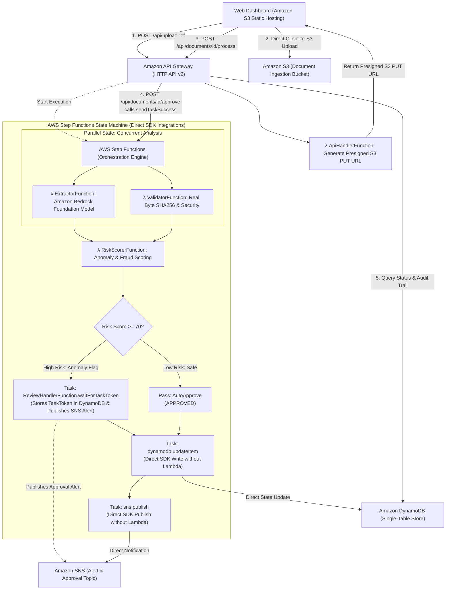

# ⚡ DocuFlow AI: Serverless Multi-Modal Document & Invoice Intelligence Engine
### Submission for the AWS Builder Center Weekend Challenge: *No Pipeline, No Problem* (Nov 13 – 16, 2026)

[](https://aws.amazon.com/serverless/)
[](https://aws.amazon.com/step-functions/)
[](https://aws.amazon.com/lambda/)
[](https://aws.amazon.com/dynamodb/)
[](https://aws.amazon.com/s3/)

---

## 📌 Problem Statement: The Operational Tax of Enterprise Invoicing
Every organization processes hundreds of invoices, receipts, and contracts weekly. Traditional document automation pipelines suffer from heavy operational friction:
- **Server Babysitting**: Provisioning and patching container clusters, load balancers, and persistent database connections for erratic document arrival patterns.
- **Premature Execution & File Bloat**: In traditional architectures, compute threads block while waiting for large files to upload.
- **Fragile Human-in-the-Loop**: Handling approvals usually requires messy polling databases, state loss during server restarts, or cron jobs checking for status changes.
- **High Idle Costs**: Paying 24/7 for servers that sit idle during off-peak hours.

**DocuFlow AI** eliminates the entire operational tax. By combining **Amazon S3, Amazon API Gateway, AWS Step Functions, AWS Lambda, and Amazon DynamoDB**, DocuFlow AI provides an enterprise-ready, scale-to-zero intelligent document processing workflow with **zero servers to manage and no complex manual deployment pipelines.**

---

## 🏗️ Architecture & Serverless Data Flow



---

## 🌟 The Serverless Building Blocks & Architectural Strengths

| Service | Architectural Role | Why It Exemplifies "No Pipeline, No Problem" |
|---|---|---|
| **Amazon Bedrock** | Serverless Multi-Modal Foundation Model Inference | Invokes Anthropic Claude 3 Haiku via the Converse API with native multi-modal document blocks (PDF) and image blocks (PNG/JPEG) using raw bytes. Extracts complex unstructured financial entities without managing inference servers, GPU clusters, or OCR pipelines. |
| **Amazon S3** | Ingestion & Static Web Hosting | Documents are uploaded directly from client to S3 using secure presigned URLs without burdening compute. Execution begins only after S3 confirms upload. |
| **Amazon API Gateway** | Managed HTTP API v2 | Low-latency REST endpoints for upload requests, document listing, processing triggers, and approval callbacks (`sendTaskSuccess`). Built-in CORS with zero load-balancer setup. |
| **AWS Step Functions** | Resilient Visual Orchestration | Uses `Parallel` fan-out for concurrent entity extraction & security scanning, native exponential retries, and `waitForTaskToken` for true asynchronous human approvals. |
| **AWS Lambda** | Decoupled Micro-Compute | Decoupled single-responsibility functions that coordinate Bedrock inference, score risk, and scale to zero instantly when idle. |
| **Amazon DynamoDB** | Single-Table State Store & Direct SDK Write | Sub-10ms reads and writes using true `Decimal` attributes for financial records, GSI1 indexes for dashboard queries, and direct ASL integration (`arn:aws:states:::dynamodb:updateItem`) without glue Lambdas. |
| **Amazon SNS** | Direct SDK Notifications & Approval Staging | Step Functions publishes approval tokens (`waitForTaskToken`) and completion events directly to SNS (`arn:aws:states:::sns:publish`) without compute overhead. |
| **AWS X-Ray** | Distributed Tracing & Service Map | Native tracing (`Tracing: Active`) across API Gateway, Lambda, Step Functions, Bedrock, DynamoDB, and SNS providing automated visual service maps. |

---

## 🤖 Why Amazon Bedrock? (True Serverless Multi-Modal AI Without Operational Tax)
Traditional document AI solutions require custom machine learning pipelines: gathering training data, running separate OCR microservices, provisioning GPU clusters (like EC2 `g5.xlarge`), and configuring auto-scaling endpoints. That is the ultimate "operational tax."

**DocuFlow AI** takes a pure serverless approach using **Amazon Bedrock**:
1. **Zero GPUs or OCR Clusters to Provision**: The `ExtractorFunction` calls `bedrock-runtime:Converse` on-demand with raw PDF document blocks and JPEG/PNG image blocks.
2. **Scale to Zero**: If no documents are uploaded, Bedrock costs $0.00.
3. **Multi-Modal Entity Reasoning**: Claude 3 Haiku natively reads document visual layout, extracting dates, tax IDs, vendor domains, line items, and risk commentary directly into strict JSON format with fail-closed integrity.
4. **Resilient Fallback**: If Bedrock is unreachable or running in an offline test sandbox, a deterministic rule engine takes over automatically.

---

## 🗄️ DynamoDB Single-Table Design

DocuFlow AI utilizes an efficient single-table access pattern with true numeric Decimals:

| Access Pattern | PK | SK | GSI1PK | GSI1SK | Attributes |
|---|---|---|---|---|---|
| Get Document Details | `DOC#{document_id}` | `METADATA` | — | — | `filename`, `status`, `extracted_data`, `risk`, `task_token`, `security_scan` |
| List Documents (Newest First) | `DOC#{document_id}` | `METADATA` | `DOCS` | `ISO_TIMESTAMP` | Projected attributes for fast dashboard rendering |

---

## 🚀 Quick Start & Deployment Guide

### Prerequisites
- Python 3.12+
- AWS CLI (`aws configure`)
- AWS SAM CLI (`sam --version`)

### 1. Build and Deploy to AWS
Deploy the complete serverless stack with a single command (override `ReviewerEmail` with your real alert email address):
```bash
sam build
sam deploy --guided
# Or pass directly:
# sam deploy --parameter-overrides ReviewerEmail=your-email@domain.com
```
SAM provisions the S3 buckets, DynamoDB table, API Gateway HTTP API with native Cognito JWT authorizer, Lambda functions, SNS topic with email subscription, and Step Functions state machine automatically.

> [!IMPORTANT]
> **SNS Reviewer Confirmation Required**: Immediately after deployment, AWS SNS sends an **"AWS Notification - Subscription Confirmation"** email to the configured `ReviewerEmail`. The recipient must open that email and click **"Confirm Subscription"** before Amazon SNS will deliver high-risk invoice approval alerts.

### 2. Configure Reviewer Account in Amazon Cognito
DocuFlow uses an enterprise-hardened Cognito User Pool where public self-registration is disabled (`AllowAdminCreateUserOnly: true`) and approvals require membership in the `Reviewers` group. Create your authorized reviewer account using the AWS CLI:

> [!WARNING]
> **Use a Strong, Private Password**: Replace `<YOUR_STRONG_PASSWORD>` below with a private password meeting Cognito's policy (minimum 8 characters with uppercase, lowercase, and numbers). Never use fixed or shared passwords in production.

```bash
# 1. Retrieve Cognito User Pool ID from deployment outputs
USER_POOL_ID=$(aws cloudformation describe-stacks --stack-name docuflow --query "Stacks[0].Outputs[?OutputKey=='CognitoUserPoolId'].OutputValue" --output text)

# 2. Create the reviewer user
aws cognito-idp admin-create-user \
  --user-pool-id $USER_POOL_ID \
  --username reviewer@example.com \
  --user-attributes Name=email,Value=reviewer@example.com \
  --message-action SUPPRESS

# 3. Set a strong permanent password (replace <YOUR_STRONG_PASSWORD>)
aws cognito-idp admin-set-user-password \
  --user-pool-id $USER_POOL_ID \
  --username reviewer@example.com \
  --password "<YOUR_STRONG_PASSWORD>" \
  --permanent

# 4. Assign user to the Reviewers group (required for document approvals)
aws cognito-idp admin-add-user-to-group \
  --user-pool-id $USER_POOL_ID \
  --username reviewer@example.com \
  --group-name Reviewers
```

### 3. Deploy Web Dashboard to S3 & Sign In
```bash
aws s3 sync frontend/ s3://<DocuFlowFrontendBucketName>/
```
*(Note: Do not supply `--acl public-read`. Modern S3 buckets disable ACLs by default; public website access is managed cleanly by the bucket policy.)*

1. Open the Output `WebDashboardUrl` in your browser.
2. Click **⚙️ Connect & Sign In** in the top navigation bar.
3. Enter your `HttpApiUrl` and `CognitoUserPoolClientId` (from SAM deployment outputs).
4. Enter `reviewer@example.com` and your chosen strong password, then click **Sign In with Cognito**.
5. The dashboard authenticates directly with AWS Cognito (`USER_PASSWORD_AUTH`), obtains your verified JWT ID token, and displays your active `Reviewer` role badge!

---

## 🔒 Security, RBAC & Production Hardening
- **Native Amazon Cognito JWT Authorizer**: The SAM template provisions an `AWS::Cognito::UserPool` (`DocuFlowUserPool`) and web client (`DocuFlowUserPoolClient`). `DocuFlowHttpApi` enforces `DefaultAuthorizer: CognitoAuthorizer` natively at the API Gateway layer. All incoming requests must provide a valid Cognito JWT ID/Access token (`Authorization: Bearer <token>`); missing, forged, or expired tokens are rejected with HTTP 401 before Lambda is invoked.
- **Role-Based Access Control (RBAC) & Tenant Isolation**:
  - **Closed Registration**: `AllowAdminCreateUserOnly: true` blocks public self-registration.
  - **Reviewer Group Enforcement**: Only users belonging to the `Reviewers` or `Admins` Cognito group can approve or reject documents via `POST /api/documents/{id}/approve` (non-reviewers receive HTTP 403 Forbidden).
  - **Strict Fail-Closed Tenant Isolation**: Non-reviewer callers can only view and process documents with a verified matching ownership claim (`owner == user_id`). Records lacking owner metadata or marked `anonymous` strictly fail closed with **HTTP 403 Forbidden** for non-reviewers. Reviewers and Admins retain organizational oversight across all documents.
- **Zero Shared Frontend Secrets**: Removed all hardcoded or predictable shared symmetric API keys from the SAM template and frontend client.
- **Fail-Closed Architecture**: All pipeline stages fail closed—unauthenticated requests return HTTP 401, missing or corrupt records return HTTP 404/500 without guessing S3 paths, and approval decisions require explicit `"APPROVE"` or `"REJECT"` actions.
- **Private Storage**: For enterprise deployments, front `DocuFlowFrontendBucket` with Amazon CloudFront using Origin Access Control (OAC).

---

## 🧪 Automated Testing
Run the comprehensive 54-test suite verifying Cognito JWT authorization, RBAC reviewer group enforcement, fail-closed tenant isolation, magic-byte inspection, multi-modal Converse API parsing, parallel fan-out, Step Functions task tokens, and decimal serialization:
```bash
python -m unittest discover -s tests/unit -p "test_*.py" -v
```

---

## 🏆 Why DocuFlow AI Wins
1. **True Asynchronous Human-in-the-Loop**: Employs AWS Step Functions' `waitForTaskToken` pattern to pause workflows without burning compute, persisted in DynamoDB and resumed via API Gateway callback.
2. **Parallel Fan-Out & Fail-Closed Guardrails**: Runs entity extraction and cryptographic SHA-256 integrity validation concurrently in Step Functions, failing closed if files are missing or tampered.
3. **Multi-Modal Bedrock Foundation Models**: Native binary PDF and image document blocks eliminate complex OCR pipelines, persisting financial data with true DynamoDB Decimals.
4. **Pristine Serverless Architecture**: Uses all 5 recommended serverless services with scale-to-zero cost.
5. **Instant Usability**: Features a fully responsive live visual dashboard and reproducible SAM IaC.
